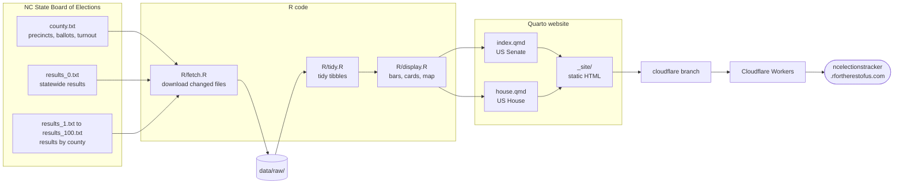
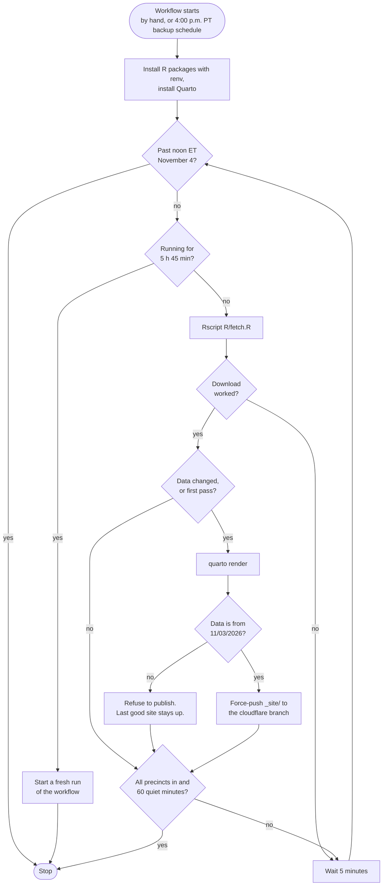
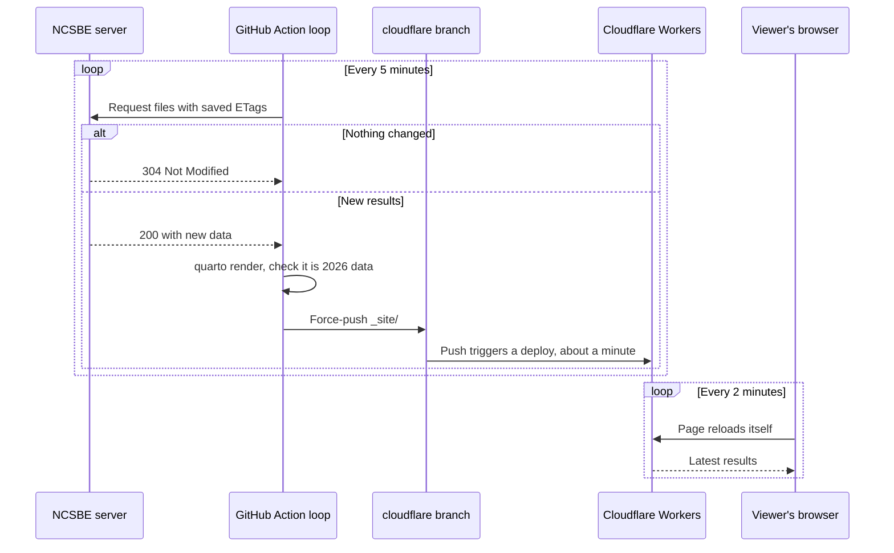
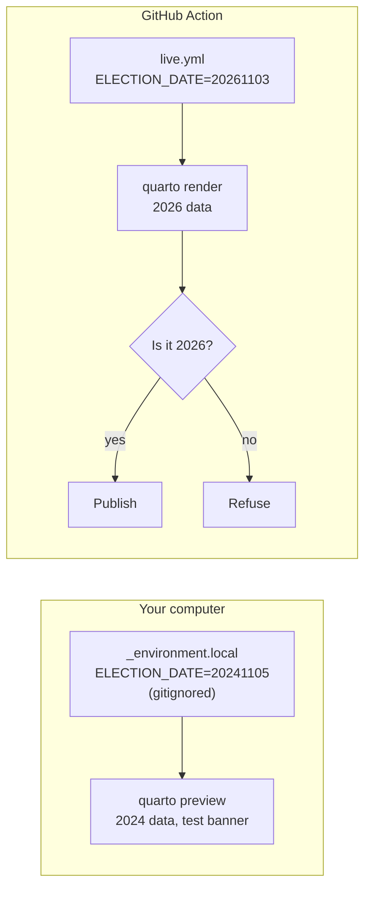

# NC election tracker

A Quarto website that shows live, unofficial results for the US Senate and US House races in North Carolina's November 3, 2026 general election. A GitHub Action checks the NC State Board of Elections every 5 minutes and republishes the site when the numbers change.

**Live site:** <https://ncelectionstracker.rfortherestofus.com>

Built live on an R for the Rest of Us livestream.

The site never calls a race. It shows who is leading, how many precincts have reported, and when the state last updated its data.

## How it works



### The data

All data comes from the state's live results server at `https://er.ncsbe.gov/enr/20261103/data/`. That is the same data the [state's results dashboard](https://er.ncsbe.gov/) reads, and the state says it updates every 5 to 10 minutes after polls close.

| File | What's in it |
|---|---|
| `county.txt` | One row per county plus statewide (`cid` 0): precincts reporting, ballots cast, registered voters, turnout, and when the state last updated |
| `results_0.txt` | Statewide results, one row per candidate in every contest |
| `results_1.txt` to `results_100.txt` | The same, for each county (`cid` 1 to 100, alphabetical) |

Every value in these files is a string. The vote-type columns are easy to mix up, so here they are, checked against the state's precinct file:

| Field | Meaning |
|---|---|
| `vct` | Total votes |
| `evc` | Election Day votes |
| `ovc` | Early (one-stop) votes |
| `avc` | Absentee by mail votes |
| `pvc` | Provisional votes |
| `prt` / `ptl` | Precincts reporting / total |

`R/fetch.R` saves each file's ETag. On the next check it sends the ETag back, and the server answers `304 Not Modified` if nothing changed. Checking all 102 files costs almost nothing when results haven't moved, and county files are only requested when the statewide numbers change.

## The publish loop

GitHub's scheduled workflows run on a best-effort basis, and on a busy night a "every 5 minutes" schedule can fire late or be skipped. So instead of a cron job per update, one long-running job loops on its own schedule.



Some details:

- **Only the Action publishes.** Nothing on a laptop pushes to the `cloudflare` branch.
- **A failed download or render never takes the site down.** The loop keeps the last good version and tries again in 5 minutes. `R/fetch.R` also refuses to overwrite good data with an empty or broken download.
- **The branch stays small.** Each update replaces the `cloudflare` branch with a single fresh commit instead of stacking up history.
- **GitHub's 6-hour job limit.** Just before it, the loop starts a new run of the same workflow and exits. The `concurrency` group makes sure two loops never run at once.

### What happens on election night



## Previewing with 2024 data

The state's 2024 results are still online in exactly the same format, so the site can be built and tested with real numbers before 2026 results exist. One setting, `ELECTION_DATE`, picks the election.



- **On your computer,** create `_environment.local` with `ELECTION_DATE=20241105`. Quarto reads it, and `quarto preview` shows 2024 results with a large "2024 test data" banner. 2024 had no US Senate race, so the Senate page shows the 2024 presidential race instead.
- **Remove that line** (or the file) to preview the 2026 site, which shows a "Polls close at 7:30 p.m. ET" message until votes come in.
- **The Action never sees `_environment.local`,** because it is gitignored, and `scripts/loop.sh` refuses to publish anything but 2026 data.

## Running it yourself

```bash
# Restore packages
Rscript -e 'renv::restore()'

# Preview locally (fetches data first)
quarto preview

# Try the publish loop without pushing anything
DRY_RUN=1 INTERVAL=20 bash scripts/loop.sh
```

Start the live loop from the repo's **Actions** tab ("Live results", then "Run workflow"), or with `gh workflow run live.yml`.

### Cloudflare setup

Cloudflare's GitHub integration (Workers Builds) deploys the `cloudflare` branch:

1. In Cloudflare, create a Worker named `nc-elections-tracker` from this GitHub repo.
2. Set the production branch to `cloudflare`, leave the build command empty, and keep the deploy command as `npx wrangler deploy`.
3. Turn off builds for non-production branches, since `main` holds source code, not the built site.
4. Add the custom domain `ncelectionstracker.rfortherestofus.com`.

`wrangler.jsonc` tells Cloudflare to serve the `_site/` folder. `_headers` tells browsers to check for a new version on every page load.

## Files

| Path | Purpose |
|---|---|
| `index.qmd`, `house.qmd` | The two pages |
| `R/fetch.R` | Downloads the state's files with ETags and writes `status.json` |
| `R/tidy.R` | Reads the raw files into tidy tibbles |
| `R/display.R` | Candidate bars, House cards, status bar, county map |
| `data/nc_counties.rds` | County outlines as a plain data frame, so the Action doesn't need `sf` |
| `scripts/make-county-shapes.R` | Makes that file once with `tigris` |
| `scripts/loop.sh` | The publish loop |
| `.github/workflows/live.yml` | Runs the loop |
| `wrangler.jsonc`, `_headers` | Cloudflare config |
| `images/nc-flag.svg` | NC state flag, public domain, from Wikimedia Commons |

## Design notes

- **Colors.** The nav bar uses navy from the NC flag. The state's official colors are red and blue, but on a results site those read as party colors, so they appear only as party colors. Democratic and Republican colors come from the state's own data. Green and Libertarian are darkened from the state's colors so their bars are visible on white.
- **Font.** North Carolina has no official statewide font, so the site uses [Public Sans](https://fonts.google.com/specimen/Public+Sans) from the US Web Design System.
- **Map.** Shading is the Democratic share minus the Republican share of all votes cast in each county. White counties have not reported yet.
